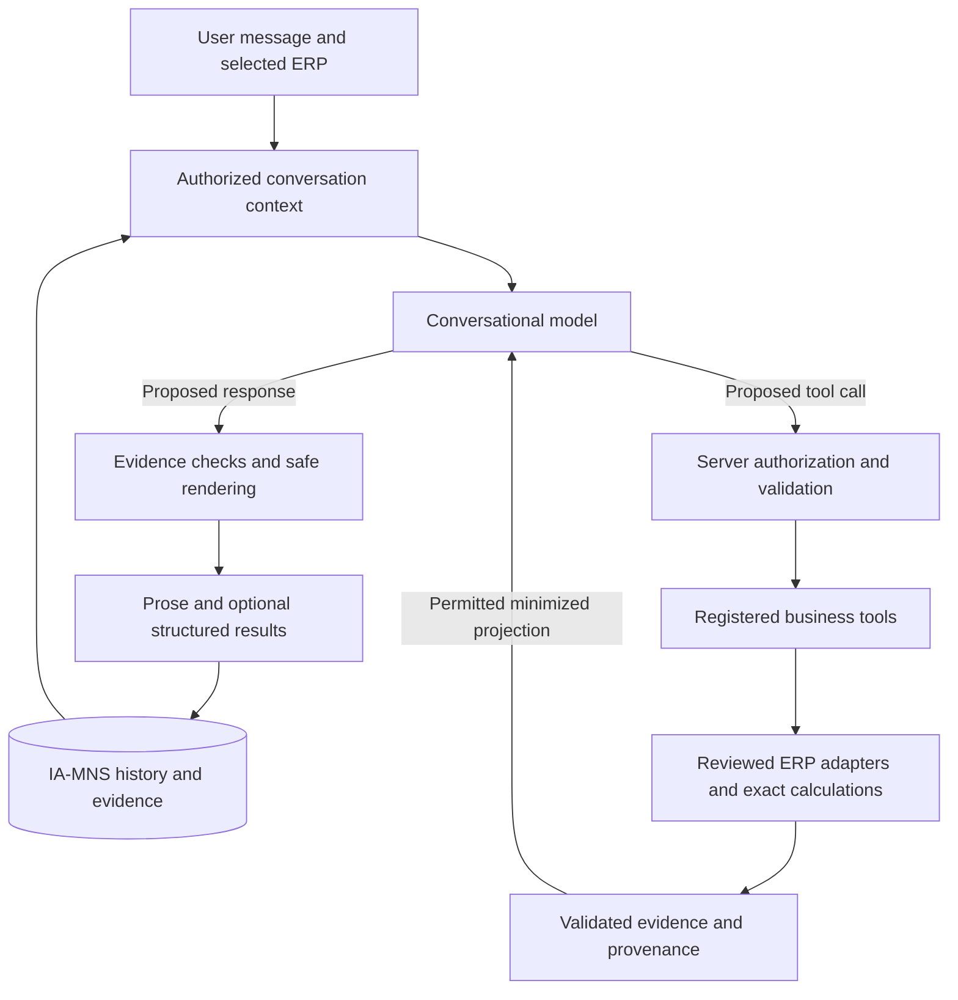

# Proposal: Conversational Autonomy with Controlled Business Tools

**Status:** historical proposal; implementation authorized by the owner on 2026-10-12 and tracked in PJ-42–46.
**Date:** 2026-10-12.
**Scope:** original repository analysis and proposed evolution of IA-MNS. The diagnosis and proposed targets below describe the baseline at the analysis date. Current behavior is owned by [conversational autonomy](../architecture/conversational-autonomy.md), [ADR-0035](../adr/0035-compose-conversations-over-authorized-evidence-and-semantic-tools.md) and the [implementation plan](implementation-plan.md#conversational-autonomy-implementation).

## Owner-authorized revision

The subsequent implementation request authorized all phases and delegated technical decisions without phase-by-phase approval. The owner also explicitly approved necessary real business data in OpenAI requests and reuse of the existing API key for synthetic evaluations. The former opaque-only/privacy-decision gate below is historical and does not block ordinary in-scope analysis. [AI data processing](../security/ai-data-processing.md) now defines allowed categories, minimization, metadata traceability, `store:false`, category-specific personal-data gates and the unverified account/legal prerequisites. No new ERP writes, grants or production deployment were authorized. The phased proposal is implemented incrementally with bounded text/CSV and PNG/JPEG attachment support; arbitrary document formats, full spreadsheet calculation and global autonomous business-rule learning are outside its validated scope.

[Documentation index](../README.md) · [Current implementation plan](implementation-plan.md) · [Human actions](human-actions.md) · [Current AI architecture](../architecture/ai-interpretation.md)

## Recommendation

Evolve IA-MNS into a conversational assistant that can reason over authorized context, write its own responses, and choose among controlled business tools. Keep data access, authorization, business definitions, query compilation, arithmetic, and execution limits in the application. The model should decide how to help within those boundaries, including when no new database query is necessary.

This addresses a broad class of requests: summarize, explain, rewrite, translate, compare available facts, adjust presentation, continue an analysis, and combine supported operations. Each phrasing should not require a new intent, conditional branch, prompt exception, or business capability. New data sources, metrics, business meanings, and side effects still require explicit integration and validation.

The immediate recommendation is a general conversation and evidence layer over the existing capabilities, followed by a bounded tool-calling loop. Retain the existing Responses API integration, PostgreSQL history, semantic product catalogs, and reviewed ERP adapters. Do not start by replacing the stack, adding multiple agents, fine-tuning, or exposing a SQL console.

## What the repository shows

This analysis inspected the actual working tree, including substantial pre-existing uncommitted sales/product work, on top of `885cf58`. That commit alone does not identify everything analyzed. The reported conversation was not replayed against the live model; no stored private conversation, ERP data, credentials, or operational model setting was read. The diagnosis below is supported by executable code and current policy, not a claim about the exact model output in that turn.

| Finding | Evidence | Effect |
| --- | --- | --- |
| The router can choose a registered capability or a small social/unavailable intent. It is expressly forbidden to produce answers or public prose. | [`routeSchema` and `createAgentPlanner`](../../apps/api/src/features/agent/planner.ts) | A legitimate writing request has no general conversational execution path. |
| Business answers in router history are replaced by an answer-delivered marker. | [`runAgentTurn`](../../apps/api/src/features/agent/application.ts) | The model cannot read the figures or explanation behind “summarize this.” |
| Sales interpretation sees filters, active/pending plans, and filter-only descriptions of answers. It cannot emit figures or public text. | [`interpreterState`, `interpreterInstructions`, `interpreterMessages`](../../apps/api/src/features/sales/interpreter.ts); [`recordExchange` use](../../apps/api/src/features/sales/application.ts) | Sales context supports query refinement, not discussion of the returned evidence. |
| The exact reported refusal is a fixed sales message. | `unsupportedMessage` in [`sales/application.ts`](../../apps/api/src/features/sales/application.ts) | The reported wording is consistent with the sales unsupported branch. The route/interpretation for the specific incident remains unverified. |
| Each model request forces exactly one named strict function call, then consumes only its validated arguments. | [`StructuredModel`](../../apps/api/src/ai/model.ts), [`createOpenAiModel`](../../apps/api/src/ai/openai.ts) | There is no general response-generation or iterative tool-result conversation in this adapter. |
| Durable turns already contain reply snapshots; execution loads up to 12 completed turns. | [`AgentRepository`](../../apps/api/src/features/agent/prisma-repository.ts), [`storedReplySchema`](../../apps/api/src/features/agent/contracts.ts) | The information is not necessarily lost. The missing piece is authorized, purpose-specific model context. Older references need bounded retrieval beyond that window. |
| Product choices and sales scope already have structured, ERP-specific state and complete-membership execution. | [`products/sales.ts`](../../apps/api/src/features/products/sales.ts), [semantic sales integration](../architecture/semantic-product-resolution.md#sales-integration) | Preserve and reuse this work; do not reconstruct a product selection from a displayed list or prose. |
| The chat sends text and a source selection and renders structured results with a text message. | [`agent/contracts.ts`](../../apps/api/src/features/agent/contracts.ts), [`agent/page.tsx`](../../apps/web/src/features/agent/page.tsx), [`ModelMessage`](../../apps/api/src/ai/model.ts) | File/image ingestion and evidence-aware prose need actual contracts and UI support; choosing a multimodal model alone does not implement them. |

The source inspection explains the failure class: IA-MNS currently uses the model as an interpreter for a restricted query workflow. It does not expose the broader conversational abilities needed to discuss an answer. Changing only the model or adding a synonym for “resumo” would leave these architectural restrictions in place.

These restrictions were deliberate. [ADR-0018](../adr/0018-bound-natural-language-sales-to-a-read-only-query-capability.md), [ADR-0019](../adr/0019-compose-a-corporate-agent-with-durable-conversations.md), and [ADR-0024](../adr/0024-interpret-analytics-through-structured-state-and-evaluate-ai-behavior.md) retain application-authored responses, deterministic financial results, and figure-free model context. A future implementation must explicitly extend or partially supersede the affected decisions rather than silently contradict them.

## What “use ChatGPT's capabilities” means here

The requested behavior is feasible using the API: a model can receive conversation context, call application functions, and produce an answer after seeing the tool results. Responses also supports file and image inputs, subject to model and input-type support. IA-MNS must implement the surrounding context, tools, permissions, persistence, and presentation; an API model setting does not import the ChatGPT application's complete product behavior. See the official [conversation-state](https://developers.openai.com/api/docs/guides/conversation-state), [function-calling](https://developers.openai.com/api/docs/guides/function-calling), [file-input](https://developers.openai.com/api/docs/guides/file-inputs), and [vision](https://developers.openai.com/api/docs/guides/images-vision) documentation.

The goal is broad conversational competence over controlled resources. The agent may explain concepts from general knowledge, clearly distinguish that from company facts, and transform user-provided material. Claims about MNS or its operations require authorized evidence. If the required evidence or tool is absent, it should describe the specific gap and any useful supported next step.

This reduces configuration of language and workflows. It cannot eliminate the need to define what “sales,” “net value,” “active product,” or a source-specific unit means. Neither a schema nor a powerful model can reliably infer all business rules, undocumented join cardinalities, or organizational permissions.

## Proposed division of responsibility

| Concern | Model autonomy | Server authority |
| --- | --- | --- |
| Conversation | Understand intent, references, tone, language, desired format, and level of detail. | Select authorized history and protect conversation ownership. |
| Planning | Answer directly, inspect evidence, request a supported analysis, or ask a meaningful clarification. | Admit only registered tools, valid arguments, permitted scopes, and bounded work. |
| Product interpretation | Use reviewed semantic descriptions and actual candidates; reuse an explicit prior choice. | Validate catalog version, ERP, grounding, ambiguity, and complete selection membership. |
| Analysis | Choose useful supported comparisons and decompositions for the user's objective. | Enforce metric meaning, source selection, date limits, unit compatibility, and exact calculations. |
| Response | Write natural prose, explain supported findings, propose hypotheses, and adapt presentation. | Bind factual claims to evidence, render canonical values, and reject unsafe or unverifiable outputs. |
| Learning | Adapt within the conversation and propose reusable preferences or new semantic candidates. | Control persistence, scope, review, revocation, and promotion into business knowledge. |
| External actions | Explain or prepare a proposed action when supported. | No ERP writes or outbound delivery tools in the initial design. Future side effects need their own authorization and delivery contract. |

Autonomy applies to completing the current user request. It does not imply background monitoring, scheduled jobs, self-modification, permission changes, or unattended external writes.

## Architecture

All components below are proposed responsibilities, not claims that new files, tool names, or APIs already exist.

### 1. Conversation with evidence

Extend the existing agent layer to assemble recent user/assistant messages, active and pending analysis state, the current focus, and references to relevant validated results. Persisted PostgreSQL records remain canonical; do not replace them with model memory or automatically send every historical result to the provider.

Represent a result as a versioned evidence object linked to its originating turn. Include source, absolute period, metric and unit, validated filters, semantic-selection provenance, catalog version, observation time, completeness/truncation status, warnings, and the permissions required to read it. Keep exact values as canonical decimal strings. Use the existing reply snapshot where possible; a separate table is justified only if lifecycle or querying needs it.

Before including any evidence, check current ownership and all dependent permissions. Repeat those checks when retrieving older turns, composing results, returning a stored response, or replaying a request. A summary derived from semantic sales inherits both `sales:read` and `products:read`; saving it as a generic conversation message with `capabilityId: null` must not bypass revocation. Derived prose, compacted memory, and exported artifacts inherit the union of their evidence dependencies.

Resolve “disso” to the current conversational focus, usually the most recent applicable result. Preserve explicitly selected product scope, source, period, and caveats. If several results are equally plausible, ask which one. If the referent is missing, deleted, inaccessible, or outside recoverable history, say so; do not reconstruct facts from general knowledge.

Use a token budget with recent messages plus targeted retrieval of older evidence. Optional compacted summaries are derived navigation aids, never the sole source of financial facts, permissions, or pending decisions. Keep evidence references and structured selections available after compaction, reload, and restart. Cross-chat retrieval and persistent user preferences should be separate explicit capabilities, not implicit global memory.

Manual context management with `store:false` is the recommended starting point because IA-MNS already owns its durable history and authorization. If an iterative Responses exchange is replayed manually, preserve the protocol items needed for continuation, including tool-call/output association and supported reasoning items; do not reduce a tool exchange to `output_text`. Provider-managed conversations or response chains would add retention/deletion obligations and are not required for this proposal. See [conversation state](https://developers.openai.com/api/docs/guides/conversation-state).

### 2. A model that can answer or use tools

Introduce a conversational model interface alongside the current structured interpretation port. It must support direct responses, multiple permitted tool definitions, tool results, and bounded continuation. Preserve strict argument schemas and application validation. The current router must not remain a mandatory gate that rejects a writing request before the conversational model sees it.

The server loop is: prepare authorized context; request a response or tool call; validate and execute an allowed call; project its evidence; continue until a final response, clarification, refusal, error, or budget limit. Tool outputs are data, not new instructions. The model proposes the sequence; code authorizes every step. This follows the [function-calling pattern](https://developers.openai.com/api/docs/guides/function-calling), with IA-MNS-specific limits.

Start with one orchestrator and the existing OpenAI SDK. An Agents SDK or other framework may reduce orchestration work later, but it is not a prerequisite. Framework choice must be evaluated against existing cancellation, tracing, persistence, and provider-data controls; it must not become a reason to enable extra tools or external traces.

| Proposed tool responsibility | Existing foundation | Required boundary |
| --- | --- | --- |
| Describe available business analyses and reviewed metric meanings. | Capability registry, sales catalog, product semantic catalogs. | Return permitted semantic descriptions, not raw schema, credentials, or unavailable capabilities. |
| Read relevant conversation evidence. | Owner-scoped turns and bounded reply snapshots. | Check ownership, dependencies, version, and field-level projection. |
| Resolve or refine a product selection. | Product resolver and source-specific AST. | Return validated candidates or a server-issued selection reference; preserve ambiguity and source isolation. |
| Execute a structured sales analysis. | Sales validation, period resolution, readers, fixed queries, decimal computation. | Revalidate every filter and selection; retain reference grain, date/result limits, and permissions. |
| Derive supported comparisons or prepare a table/chart from evidence. | Existing comparison and result machinery, extended only where needed. | Calculate in code; expose only implemented operations; validate units, compatible periods, and completeness. |

Initially, adapters may reuse current capability execution. The target interface should accept validated structured plans or selection references rather than repeatedly reinterpreting a natural-language request at every layer. Reuse the domain validators/compiler; do not create a second sales semantics engine. Existing strict interpreters remain useful wherever a bounded interpretation step adds reliability.

The model must not broaden a request after a tool rejects a filter, loses a permission, encounters a stale selection, or reaches a size limit. It may repair a schema error once within budget if user intent is unchanged; it may not silently remove conditions to obtain an answer. A mixed request requiring unsupported business data must remain explicit about that limitation. Rewriting an existing answer, however, should not be classified as a new unsupported sales metric.

### 3. Natural language grounded in verified facts

Send only the evidence needed to answer. For a narrative summary, this might be the selected product scope, period, per-source totals, units, and relevant caveats. A request for a monthly trend requires actual monthly evidence; a single total does not support a claim of growth. Additional metrics, comparisons, and ratios must come from a validated computation, not model arithmetic.

Use evidence-linked response segments for quantitative statements: a segment references a known fact or deterministic derived fact with its measure, source, period, unit, and polarity. The renderer inserts the canonical value. For example, a synthetic paragraph template can refer to `sales.total` and `sales.period` without allowing the model to invent a financial amount. The model still chooses the surrounding explanation, ordering, and style.

Validate the relationship, not merely whether a number appears somewhere in a result. The same amount can be attributed to the wrong ERP or period. Mandatory caveats, incomplete-source status, and current-registration semantics must survive rewriting. Avoid merging `Tudo` results: the current source policy presents them separately. Zero, no data, unavailable data, and an undefined percentage are different states.

Structured output and numeric binding do not prove that every sentence is true. A model can use valid facts with misleading causality, comparisons, or certainty. Keep a clear distinction between observations and hypotheses; do not state a cause, forecast, or recommendation as an established company fact without evidence. Use semantic evaluations and review, with conservative rendering for financial assertions. If a response cannot pass its evidence checks, retain the validated result and offer a safe explanation or fallback rather than publishing unsupported prose.

The UI should retain structured result cards and provenance while permitting prose-only follow-ups. Tables and charts should use approved renderers and server-issued data references. Do not render model HTML, JavaScript, remote image URLs, or executable chart specifications. Text generation does not require replacing the current visual language or introducing streaming; if streaming is later added, financial assertions need validation before display.

### 4. Semantic knowledge that does not require rules for every phrase

Maintain the distinction between business knowledge and language interpretation. Continue to describe each data source through reviewed entities, relationships, measures, dimensions, units, defaults, and examples. Let the model combine those concepts and choose workflows. Retrieve relevant catalog descriptions rather than stuffing the entire schema into every prompt.

The existing product catalogs, targeted metadata retrieval, and complete-selection compiler are a strong foundation. Discovery may propose new relationships or meanings; runtime should use only reviewed, executable entries. Granting access to a column does not verify its semantics or activate it. Current open dimensions and business questions remain governed by [PJ-36](implementation-plan.md#current-work), [PH-28](human-actions.md#ph-28), and the domain documentation.

Keep a confirmed “apple” selection within the conversation. A later summary or period change should not reopen the same ambiguity. For a new ambiguous request, weigh whether the choice materially changes the result: formatting and harmless presentation choices can be automatic; fruit versus every description containing the word can change financial totals and may warrant clarification. Model confidence alone is insufficient evidence to silently select the business scope.

Optional durable preferences can reduce repeated questions across chats, but they must be explicit, user-scoped, ERP/catalog-version-scoped, inspectable, correctable, and revocable. One person's choice must not silently redefine “apple” for the entire company. Suggested synonyms and business definitions enter a review queue; they do not modify code, prompts, permissions, or the catalog autonomously.

### 5. Files and images as another evidence source

File and image understanding is a later, separable capability. It is not needed to fix discussion of results already held by IA-MNS. Implement uploads, ownership, type/size/page limits, malware and parser isolation where applicable, protected storage, lifecycle/deletion, and model-safe content projection. Do not accept arbitrary file paths or fetch model-selected URLs.

For a document, retain page/section provenance; for an image, preserve its reference and indicate uncertainty in extracted text. Treat embedded instructions as untrusted document content. A file's claim about a sales amount is user-supplied evidence, not automatically an ERP-reconciled fact. Spreadsheet totals need complete, validated parsing and deterministic calculation; partial extraction cannot establish full-workbook totals. Supported file processing varies by type, as described in the official [file-input guide](https://developers.openai.com/api/docs/guides/file-inputs), while image analysis needs a [vision-capable integration](https://developers.openai.com/api/docs/guides/images-vision).

For large document collections, add permission-aware retrieval only when needed. Revalidate authorization before returning a passage; bind citations to the correct file version and propagate deletion to extracted text, indexes, caches, and provider objects. Vector retrieval is an optional search technique, not a replacement for business queries or an immediate requirement for this conversation problem.

## Privacy decision required before real-result narration

Today, sales results and financial response prose are deliberately kept out of OpenAI requests. Reusing the same provider or keeping `store:false` does not authorize expanding that payload. [Data classification](../security/data-classification.md) and [retention](../security/data-retention.md) apply to every projection and derived response.

| Option | Model receives | Tradeoff |
| --- | --- | --- |
| Minimized business evidence — recommended, subject to approval. | Only authorized aggregates, labels, period, source, warnings, and selected deterministic derived facts needed for the task. | Enables richer analysis and explanation; expands the external processing of confidential business data. |
| Opaque fact references with local value substitution. | Approved labels/structure and fact identifiers; financial values stay on the server. | Supports flexible rewriting and presentation with less disclosure; the model cannot freely reason about hidden magnitudes. Even qualitative comparisons can disclose information and need classification. |

The second option still changes the application-authored-prose rule, but can support an incremental design if sending financial values is not approved. Neither option entails sending raw ERP rows, customer records, connection settings, or entire conversations by default. The first better matches the requested analytical autonomy.

Before using real evidence, record the allowed fields, purposes, provider/account controls, retention/deletion, access, and applicable residency requirements. Resolve this through the existing [PH-09](human-actions.md#ph-09) policy work and, for production, [PH-23](human-actions.md#ph-23). A single reviewed data-processing policy should cover ordinary in-scope summaries; users should not face a fresh approval prompt for every paraphrase.

OpenAI distinguishes application state from abuse-monitoring retention. `store:false` alone is not Zero Data Retention; availability and restrictions of retention controls depend on account and feature configuration. Those settings were not verified in this analysis. See the official [data-controls documentation](https://developers.openai.com/api/docs/guides/your-data).

## Security and operating limits

| Risk | Proposed enforcement |
| --- | --- |
| Accessing another person's results or retaining revoked access through prose. | Scope history/evidence by verified owner; check current dependent permissions at context assembly, tool execution, publication, history access, and replay; cover derived messages and compacted state. |
| Instructions hidden in a product description, attachment, or tool result. | Keep fixed policy separate from untrusted content; use typed tool arguments and minimized outputs; enforce authority outside the model; test adversarial content. |
| Raw SQL, schema exploration, arbitrary network calls, or secret access. | Expose none of these as runtime tools. Retain reviewed compilers and isolated Administration/Discovery. A model never obtains ERP or provider credentials. |
| Financial errors or unsupported conclusions. | Deterministic calculations, evidence-bound quantitative claims, per-source results, explicit warnings, semantic evaluations, and safe fallback. |
| Accidental data transmission through prose, links, traces, or artifacts. | Authorize/minimize context before transmission; use safe text/renderers and allowlisted destinations; disable external tracing of content by default; inherit classification and retention for derivatives. |
| Infinite planning, repeated expensive queries, or budget exhaustion. | Server-enforced call/token/time/query budgets, repeated-call detection, cancellation propagation, and a clear terminal response. Model confidence or tool annotations do not override limits. |
| Replaying a turn after an unknown outcome. | Preserve existing request UUID and persistence semantics; do not restart chargeable work automatically or revive interrupted execution on reload. |
| Cross-source or stale semantic reuse. | Bind evidence and selections to ERP, catalog version, observation time, and permissions. Refuse invalid reuse without broadening to all products. |

Prompt instructions are useful but are not an authorization boundary. Official [agent-safety guidance](https://developers.openai.com/api/docs/guides/agent-builder-safety) discusses untrusted inputs, data leakage, and structured isolation; it also recognizes residual risk. This proposal applies those principles without selecting Agent Builder or assuming perfect injection prevention.

Start with conservative experimental budgets: up to four model requests and six tool invocations per turn, an explicit total token allowance, and the existing 90-second turn deadline, whichever limit is reached first. These are candidate limits for measurement, not implemented settings or a promise that all semantic workflows fit. Retain tighter domain/query limits and reserve time for final composition. Measure latency and cost before revising them; do not simply extend every timeout.

Keep metadata traces for model/prompt/tool versions, permissions decisions, safe outcome codes, tool counts, tokens, latency, and evidence-validation failures. Do not log confidential prompts, results, attachments, model reasoning, or raw provider output. Any stored provider continuation items inherit confidential handling and need a defined lifecycle; operational traces should not become a second conversation archive.

The current [PH-30](human-actions.md#ph-30) record reports inherited VRMaster `PUBLIC` CREATE/TEMP privileges. This analysis did not re-audit the live database. Do not describe the database identity as effectively incapable of all DDL while that item is open. The proposed runtime tools remain fixed read operations; the documented ACL gap is a reason to retain that boundary, not to introduce arbitrary execution or change global grants within this work.

## Expected behavior for the motivating case

The following dialogue uses the reported wording as a behavioral example, with no real sales values or product counts.

1. **“Quanto vendi de maçã nos últimos 3 meses?”** The assistant resolves the period using the existing business-date rule and requests a sales analysis. If the product resolver finds materially different meanings, it asks one focused choice.
2. **“Opção 1.”** The pending sales request resumes with the confirmed semantic selection. The server computes the answer and saves its evidence, explicit period, source, warnings, and selection provenance. Displayed product-list limits must not become limits on sales membership.
3. **“Me passe um resumo disso em forma de texto contínuo.”** The assistant uses that stored evidence, checks current permissions, and writes a paragraph. It does not execute another ERP query, change filters, ask for the period again, or route the request through the unsupported-sales branch.
4. **“Mais curto” / “Explique para alguém que não é da área” / “Traduza para inglês.”** The same conversation mechanism transforms the answer without new intent-specific implementation.
5. **“E em relação aos três meses anteriores?”** This requires a comparison. The assistant uses supported tools while preserving scope, and must distinguish three prior completed calendar months from the existing `previous_period` rule, which uses an equal number of days. It must use valid explicit ranges where supported or explain the limitation; it must not silently substitute one meaning for the other.
6. **“Por que caiu?”** If the evidence contains a decline, it can describe it and investigate available breakdowns. It cannot assert a cause from totals alone. It should label hypotheses and name any missing evidence, such as stock availability or pricing, without pretending those tools exist.

For “last three months,” keep the existing default of three completed calendar months. A prose-only follow-up preserves the originally executed dates even if the calendar has advanced. “Atualize com os dados de hoje” authorizes a fresh read within existing permissions; the answer should identify that it is new evidence.

## Incremental implementation proposal

These phases are recommendations, not activated tasks. The existing implementation plan and human-action statuses are unchanged by this analysis.

| Phase | Deliverable | Acceptance before proceeding |
| --- | --- | --- |
| A. Agree on boundaries and characterize behavior. | A new reviewed ADR specifying which parts of ADR-0018/0019/0024 change; the allowed provider projection; synthetic baseline conversations and data-handling tests. | Privacy option selected; authorization/provenance design covers derived prose; existing numerical/domain guarantees retained. Real-data work remains gated by the applicable policy. |
| B. General conversational responses over existing evidence. | Authorized context builder, evidence references, free-form response composition with grounded facts, generic rewriting/explanation, compatible history/UI rendering, deterministic fallback. | The motivating dialogue and varied reformulations pass; summaries cause zero new ERP reads; no lost pending state or source scope; revocation blocks derived responses. |
| C. Bounded tool planning and composition. | One conversational orchestrator choosing among registered read/analysis tools; structured domain entry points; cancellation, budgets, provenance, and failure handling. | Unseen combinations of supported operations succeed without phrase-specific branches; all attempted tool calls are validated; unsupported scope never broadens silently. |
| D. Attachments and retrieval. | Authorized file/image ingestion, provenance, safe extraction, lifecycle, and optional retrieval over approved documents. | The assistant summarizes uploaded material with correct provenance; injection, cross-owner access, incomplete extraction, and deletion tests pass. |
| E. Deliberate preference memory and continuous improvement. | User-managed persistent preferences; reviewed semantic candidates; evaluation-driven prompt/model changes. | Preferences do not become global business rules, survive only their intended lifecycle, and cannot weaken permissions or query semantics. |

Phase B is the smallest useful implementation that fixes the reported class of failures. Phase C is the broader autonomy direction. Files, vector search, and long-term memory should not block delivery of conversation over results already available.

Roll out behind a reversible server-side feature flag with the current behavior as fallback. Start with synthetic data, then a separately authorized local real-data pilot, then selected authenticated users after applicable operational prerequisites. Shadow comparisons must follow the same provider-data policy; sending real data in shadow mode is still transmission. Do not automatically rerun ERP reads to measure quality. Rollback must preserve readable history and its permission dependencies, not discard new replies or expose them as unprotected generic messages.

## Repository impact if implementation is later authorized

| Area | Expected change |
| --- | --- |
| `apps/api/src/ai/` | Add conversational/tool continuation support beside the strict model port; preserve provider failure handling and safe invocation metadata. |
| `apps/api/src/features/agent/` | Context assembly, evidence focus/retrieval, tool dispatch, budgets, evidence-aware reply contracts, and derived-result authorization. |
| `apps/api/src/features/sales/` and `products/` | Reuse domain validators, selections, adapters, and deterministic math through structured tool entry points. Add a new analytical operation only with its own semantics and tests. |
| `apps/api/prisma/` | Assess versioned reply/context changes first. If storage additions are needed, use reviewed additive migrations and metadata; preserve old snapshots, deletion, replay, and role grants. |
| `apps/web/src/features/agent/` | Natural prose and evidence references alongside existing cards; safe approved charts later; attachment workflows only in Phase D. |
| `apps/api/evals/` and existing tests | Extend current harness to tool trajectories, response grounding, long conversations, refusal/clarification quality, safety, latency, and cost. |
| Contracts, SDK, documentation | Update canonical schemas and regenerate OpenAPI/SDK/portal; record the new ADR and actual execution/human-action status when implementation begins. |

Compatibility work includes stored reply versions, the current `capabilityId`-based history authorization, 10,000-character reply limits, 20 progress-event limits, pending version-3 semantic sales state, and legacy sales HTTP behavior. Do not change those boundaries accidentally while introducing narrative replies. Progress should reflect actual reads/composition; a summary should not display a fabricated ERP-query stage.

## Validation and success criteria

Build on the existing [AI evaluation framework](../architecture/ai-evaluation.md), which already supports curated multi-turn cases, deterministic replay, live model comparison, and unreviewed synthetic candidates. Test families and invariants rather than maintaining one patch per wording. Compare the current pipeline and the proposed one on the same synthetic cases, with prompt/model/tool versions recorded.

| Family | Required evidence |
| --- | --- |
| Narrative transformations | Summary, continuous prose, shorter/longer versions, explanation, translation, and drafting from results without a phrase whitelist. Exact facts and caveats preserved; no unnecessary ERP read. |
| Context continuity | Product choice, intervening social messages, multiple results, older referenced turns, restart, compaction, source changes, deleted/inaccessible evidence, and unresolved ambiguity. |
| Numerical truth | Decimal values, quantity units, unavailable VRMaster weight, zero/empty results, undefined percentages, mixed units, partial source failures, and truncated display lists. |
| Composed analysis | Valid comparisons and breakdowns, explicit period semantics, complete product membership, no invented dimensions, and no interpretation of a presentation request as a new query. |
| Authorization | Another owner's IDs, missing/revoked permissions, semantic sales dependencies, saved prose/history/replay, and future attachment/reference isolation. |
| Adversarial inputs | Instructions in messages, product labels, documents, and tool output; forged references; requests for SQL, credentials, writes, or external transmission; repeated-call and oversized-context attacks. |
| Operations | Cancellation, deadline and token/call limits, interrupted leases, provider refusal/incomplete output, safe fallback, no automatic chargeable retries, and accurate progress. |
| Attachments, when implemented | Provenance, extraction fidelity/completeness, damaged files, misleading images, upload authorization, safe rendering, and deletion of derivatives. |

Deterministic checks must cover all access, arithmetic, provenance-reference, query-scope, and execution-budget invariants. Use human review and optionally an advisory model judge for clarity, relevance, and unsupported qualitative claims; a judge must not be the sole authority for financial or security correctness. Generated cases remain candidates until reviewed, as today.

Suggested release criteria: all deterministic safety/domain gates pass; zero unauthorized calls or unsupported numeric claims in the curated suite; at least 95% successful completion on a reviewed held-out set of supported conversations; zero ERP calls for pure rewriting of available evidence. Track unnecessary clarifications, false refusals, evidence fidelity, p50/p95 latency, tool counts, and cost per completed request. These are proposed targets, not measured results or proof of universal reliability. Establish acceptable latency and spend from the pilot before shared rollout.

## Decisions to make at implementation time

1. Approve the proposed conversational boundary and record the ADR change while preserving deterministic business computation.
2. Select the provider-data option and permitted fields; resolve the relevant retention/access controls once for the feature, not for every turn.
3. Define acceptable quality, latency, and spend; benchmark an eligible model against the existing `ai.model` configuration. This analysis did not read or change that live setting, and no particular model upgrade is required by the diagnosis.
4. Decide whether attachments and persistent preferences belong in the first release or remain later phases. The recommendation is to deliver conversational evidence first.

No implementation, live-provider verification, ERP reconciliation, migration, remote CI, or deployment is claimed by this proposal. Existing business confirmations, production prerequisites, and the PH-30 ACL item remain visible in their canonical documents. This work produces analysis and documentation only.

## Sources and maintenance

Repository links above identify the executable implementation and governing policies inspected. Official OpenAI documentation was consulted on 2026-10-12 for API capabilities, tool flow, input modalities, and provider-data controls; external capabilities and account eligibility must be rechecked when implementing. Architectural recommendations, phase boundaries, budgets, and acceptance targets are this proposal's judgments, not claims that the referenced APIs implement IA-MNS's controls automatically.

The owner of future agent changes should update or replace this proposal when a decision is accepted. Current behavior remains owned by the domain/architecture documentation, execution status by the implementation plan, and actual owner prerequisites by the human-action checklist.
